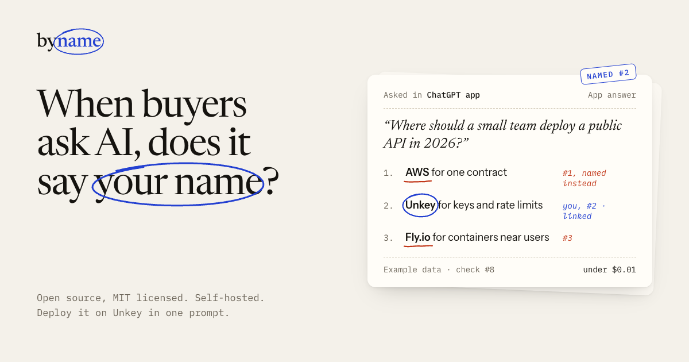
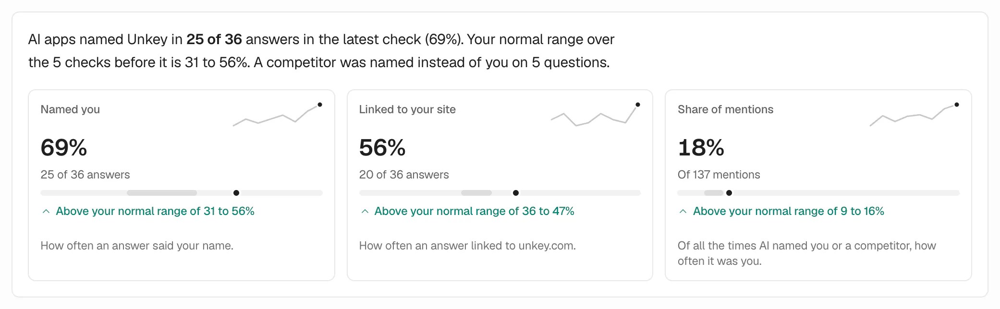
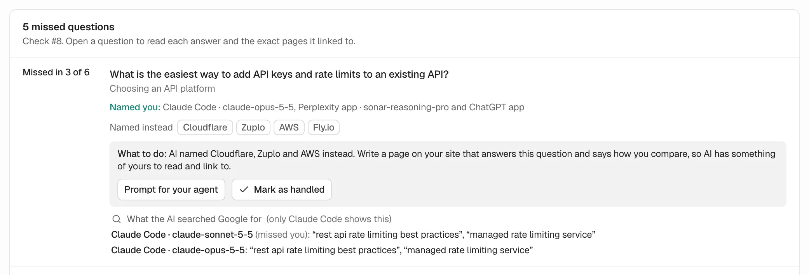
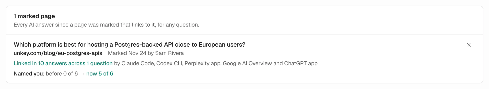

<p align="center">
  
</p>

<h1 align="center">Byname</h1>

<p align="center">
  Open source AI visibility tracker (AEO / GEO).<br />
  Find out when AI assistants name you. And who they name instead.<br />
  <a href="https://byname.dev">Website</a> · <a href="docs/">Docs</a> · <a href="https://byname.dev/#deploy">Deploy on Unkey</a>
</p>

Your buyers ask ChatGPT, Google AI Mode and Claude Code which product to use. Each answer names a few brands and links a few sites. When yours is not one of them, nothing tells you, and nothing tells you who was named instead.

Byname is an open source AI visibility tracker (AEO / GEO) you run yourself. It asks those questions where your buyers ask, on a schedule you set, keeps every answer with its cost, and counts who was named and whose site was linked. Your Google and Bing search numbers sit on the same timeline, and your agents read it all over MCP and REST.

<picture>
  <source media="(prefers-color-scheme: dark)" srcset="docs/images/this-week-dark.webp" />
  
</picture>

<sub>The screenshots show example data for Unkey, with AWS, Fly.io, Cloudflare and Zuplo as competitors.</sub>

## Why Byname

- **What a person sees, or labeled as not.** You pick the AI apps people use, not the models behind them. There are 12, including the ChatGPT app, Google AI Mode, Microsoft Copilot and Claude Code. Each one is pinned to the endpoint closest to the real app, and every answer is labeled **Real app answer**, **Same model, not the full tool**, or **Stand-in (not the real app)**. Labels are charted apart and never averaged.
- **Every answer kept.** The raw response, the cost of every call, every brand named with its position, and every link. A call that reported no cost is flagged, never stored as $0.
- **Who else gets named.** Byname reads each answer for the brands it offers instead of you. A brand you don't track is listed once answers to 3 questions offer it, and one click tracks it as a competitor.
- **Who talks about you.** Turn on social mentions, and Byname searches X, Reddit, Hacker News, LinkedIn, YouTube, Threads and Bluesky for posts that name you. It keeps only posts that use your name as a whole word, and hides the accounts you leave out, such as your team's.
- **Told when it moves.** Byname notifies you when a check gains or loses answers, a spend cap is reached or a social digest is ready. Notifications show under the bell, and can also go to email, Slack or a webhook.
- **Your keys, your limits.** One Treg token runs every AI app, or bring your own provider keys and gateways, app by app. A spend cap per check, $5 by default, stops a check that passes it. A monthly cap covers checks, social searches and reading answers for other brands. If you set none, finishing onboarding sets one at three times the monthly estimate.
- **Built for agents.** Claude Code, Cursor and other MCP clients sign in as you in the browser, with the scopes you pick. Scripts use scoped API keys that can expire.
- **MIT licensed. Yours to run, change and keep.** One container and a Postgres database, on Unkey or any host. The scheduler runs inside it, so there is no cron to set up. It opens at most 20 database connections, and fewer on a small database.

## Close the gap

**AI answers > Missed questions** lists each question an AI app answered without naming you. It shows which apps named you, the brands named instead, and what to write. **Prompt for your agent** opens a brief for the coding agent that works on your site: how each app answered, who it named, what it searched for and the pages it linked to.

<picture>
  <source media="(prefers-color-scheme: dark)" srcset="docs/images/missed-dark.webp" />
  
</picture>

Once the page is live, click **Mark as handled** and paste its address. Byname then counts every later answer that links to the page, from any AI app and for any question, and shows whether the question starts naming you. See [Handled questions](docs/handled.md).

<picture>
  <source media="(prefers-color-scheme: dark)" srcset="docs/images/handled-dark.webp" />
  
</picture>

## Get started

### Deploy on Unkey with one prompt

Add Unkey's MCP server to your coding agent:

```sh
claude mcp add --transport http unkey https://mcp.unkey.com
```

Then copy the deploy prompt from the landing page, [byname.dev](https://byname.dev/#deploy), into the agent. The same prompt is in [`site/src/lib/prompt.ts`](site/src/lib/prompt.ts), and served as Markdown at [byname.dev/deploy-prompt.md](https://byname.dev/deploy-prompt.md). It asks for your Postgres URL, forks Byname to your GitHub account with the GitHub CLI, deploys your fork to Unkey, and gives you the link to create your account. To do it by hand, follow [Deploy on Unkey](docs/deploy-unkey.md).

### Run it locally with Docker

You need Docker with Compose v2.

```sh
git clone https://github.com/unkeyed/byname.git
cd byname
echo "ENCRYPTION_KEY=$(openssl rand -base64 32)" >> .env
docker compose up -d --build --wait
docker compose logs app | grep -A2 'Open this link'
```

Open the link Byname prints and register a passkey. Onboarding then asks for your brand and domain, competitors, questions, the AI apps to ask, the search engines to read, social mentions, and the schedule and spend caps, then shows a review. Nothing runs until you finish it. Keep `.env`. The `ENCRYPTION_KEY` in it protects the provider keys and secrets Byname stores. To run it on your own server, see [Self-host Byname](docs/self-hosting.md).

## Choose your AI apps

Pick AI apps in onboarding, or later under **Settings > AI apps**. Tick the AI apps your buyers use, and paste one Treg token under **Settings > Treg**. [Treg](https://treg.to) is the service that runs each question and bills you per answer. Developer tools such as Claude Code take one or more of your team's models. Every AI app and model makes one short test call before the first check, which confirms its accuracy label.

[AI apps and accuracy labels](docs/engines/surfaces.md) · [Treg](docs/engines/treg.md) · [Scraping providers](docs/engines/scraping-providers.md) · [Model providers](docs/engines/model-providers.md) · [Gateways](docs/engines/gateways.md)

Not using Treg? Any AI app can call its endpoint at DataForSEO, cloro or SerpApi with your own key, and keeps its accuracy label. An AI app can also call OpenAI, Anthropic, Gemini or Perplexity directly, or an OpenAI-compatible gateway. On those routes an app becomes a Stand-in.

## Connect Google and Bing

In onboarding's **Search engines** step, or later under **Settings > Search engines**, connect Google Search Console, Bing Webmaster Tools or both. For Google, click **Sign in with Google**, or paste a service account's JSON key. Byname asks Google for read-only access and backfills about 16 months on the first sync. Sign in with Google needs your own Google OAuth client in `GSC_GOOGLE_CLIENT_ID` and `GSC_GOOGLE_CLIENT_SECRET`. For Bing, paste the API key from Bing Webmaster Tools and pick the site. Byname syncs each engine once a day and shows one engine at a time, since their days and what they count differ. [Search engines](docs/search.md) shows how to create the Google OAuth client and how Bing's weekly numbers differ from Google's, and covers branded search terms and goals.

## Connect your agents

```sh
claude mcp add --transport http byname https://<your-byname>/mcp
```

There is no key to copy. Run `/mcp` in Claude Code, pick `byname`, and choose **Authenticate**. Your browser opens, you sign in to Byname and pick the scopes, and the agent acts as you. Ask it which questions you lost since the last check, which competitors the answers named instead, or to queue a check. [Agents](docs/agents.md) covers Cursor, Claude Desktop, the REST API and the scope table.

## Documentation

| Guide | What it covers |
|---|---|
| [Self-host](docs/self-hosting.md) | Run Byname with Docker Compose or on any container host, upgrades, backups and recovery |
| [Deploy on Unkey](docs/deploy-unkey.md) | Every step of an Unkey deployment |
| [Configuration](docs/configuration.md) | Every environment variable |
| [Sign-in](docs/sign-in.md) | Passkeys, Google, GitHub, OIDC, roles, two-factor and recovery |
| [AI apps](docs/engines/surfaces.md) | Every AI app Byname asks, the accuracy labels, models, routes and known gaps |
| [How answers are scored](docs/scores.md) | Named you, questions that name your brand, and aliases that are everyday words |
| [Other brands](docs/other-brands.md) | The brands answers offer instead of you, how many questions it takes to list one, and logos |
| [Handled questions](docs/handled.md) | Marking a missed question as handled by a page, and tracking the answers that link to it |
| [Search engines](docs/search.md) | Google Search Console and Bing Webmaster Tools, the Google OAuth client, the sync, how the two engines differ, branded terms and goals |
| [Agents](docs/agents.md) | MCP over OAuth, the REST API, API keys and scopes |
| [Notifications](docs/notifications.md) | The bell, where notifications go (email, Slack and webhooks), each kind, and webhook signatures |
| [Site changes](docs/changes.md) | Site changes from GitHub, when Google sees them, and results against comparison pages |
| [Social](docs/social.md) | Posts that name you on seven social networks, the people you leave out, and the digest |

## Contributing

[CONTRIBUTING.md](CONTRIBUTING.md) explains how to run Byname from source, run the tests, and add an AI app.

## License

[MIT](LICENSE). Provided by [Unkey](https://www.unkey.com).
