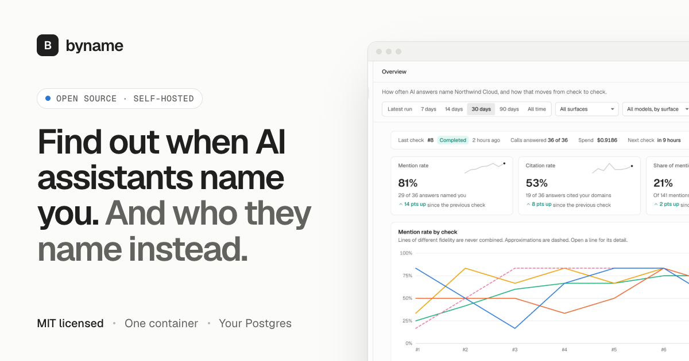

<p align="center">
  
</p>

<h1 align="center">Byname</h1>

<p align="center">
  Find out when AI assistants name you. And who they name instead.<br />
  <a href="https://byname.dev">Website</a> · <a href="docs/">Docs</a> · <a href="https://byname.dev/#deploy">Deploy on Unkey</a>
</p>

Byname is an open source app you run yourself that shows how your brand shows up in AI answers and in Google search. It asks your questions where your buyers ask them, such as the ChatGPT app, Google AI Mode or Claude Code, on a schedule you set, keeps every answer with its cost, and counts who was named and cited. Your Search Console numbers sit on the same timeline, and your agents read it all over MCP and REST.

## Why Byname

- **What a person sees, or labeled as not.** You pick surfaces, not engines. Each one is pinned to the endpoint closest to the real app, and every answer is labeled App answer, Same model and search, or Approximation. Labels are charted apart and never averaged.
- **Every answer kept.** The raw response, the cost of every call, every brand mention with its position, and every citation. A call that reported no cost is flagged, never stored as $0.
- **Your keys, your limits.** One Treg token runs every surface, or bring your own provider keys and gateways, surface by surface. A spend cap per check and an optional monthly cap bound the bill.
- **Built for agents.** Claude Code, Cursor and other MCP clients sign in as you in the browser, with the scopes you pick. Scripts use scoped API keys that can expire.
- **MIT licensed. Yours to run, change and keep.** One container and a Postgres database, on Unkey or any host. The scheduler runs inside it, so there is no cron to set up.

## Get started

### Deploy on Unkey with one prompt

The fastest way to a running Byname. Add Unkey's MCP server to your coding agent:

```sh
claude mcp add --transport http unkey https://mcp.unkey.com
```

Then copy the deploy prompt from the landing page, [byname.dev](https://byname.dev/#deploy), into the agent. The same prompt is in [`site/index.html`](site/index.html). It asks for your Postgres URL, deploys Byname to Unkey, and gives you the link to create your account. To do it by hand, follow [Deploy on Unkey](docs/deploy-unkey.md).

### Run it locally with Docker

You need Docker with Compose v2.

```sh
git clone https://github.com/unkeyed/byname.git
cd byname
echo "ENCRYPTION_KEY=$(openssl rand -base64 32)" >> .env
docker compose up -d --build --wait
docker compose logs app | grep -A2 'Open this link'
```

Open the link Byname prints and register a passkey. Onboarding then asks for your brand, competitors, questions, where people ask, Search Console and the schedule. Keep `.env`: the `ENCRYPTION_KEY` in it protects the provider keys and secrets Byname stores. To run it on your own server, see [Self-host Byname](docs/self-hosting.md).

## Connect your engines

Open **Settings > Where people ask**, tick the surfaces your buyers use, and paste one Treg token under **Settings > Credentials**. Developer tools such as Claude Code take one or more of your team's models. Every surface and model pair makes one short test call before the first check, which confirms its fidelity label.

[Surfaces and fidelity](docs/engines/surfaces.md) · [Treg](docs/engines/treg.md) · [Scraping providers](docs/engines/scraping-providers.md) · [Model providers](docs/engines/model-providers.md) · [Gateways](docs/engines/gateways.md)

Not using Treg? Any surface can call DataForSEO, cloro or SerpApi with your key and stay an App answer, or call OpenAI, Anthropic, Gemini, Perplexity or an OpenAI-compatible gateway directly, which makes an app surface an Approximation.

## Connect Search Console

In onboarding's **Search Console** step, or later under **Settings > Search Console**, click **Sign in with Google**, or paste a service account's JSON key. Byname asks Google for read-only access, syncs once a day, and backfills about 16 months on the first sync. Sign in with Google needs your own Google OAuth client in `GSC_GOOGLE_CLIENT_ID` and `GSC_GOOGLE_CLIENT_SECRET`. [Search Console](docs/search-console.md) shows how to create one, and covers branded search terms and goals.

## Connect your agents

```sh
claude mcp add --transport http byname https://<your-byname>/mcp
```

There is no key to copy. The first time, your browser opens, you pick the scopes, and the agent acts as you. Ask it which questions you lost since the last check, which competitors the answers named instead, or to queue a check. [Agents](docs/agents.md) covers Cursor, Claude Desktop, the REST API and the scope table.

## Documentation

| Guide | What it covers |
|---|---|
| [Self-host](docs/self-hosting.md) | Run Byname with Docker Compose or on any container host, upgrades, backups and recovery |
| [Deploy on Unkey](docs/deploy-unkey.md) | Every step of an Unkey deployment |
| [Configuration](docs/configuration.md) | Every environment variable |
| [Sign-in](docs/sign-in.md) | Passkeys, Google, GitHub, OIDC, roles, two-factor and recovery |
| [Where people ask](docs/engines/surfaces.md) | Surfaces, fidelity labels, models, routes and known gaps |
| [Search Console](docs/search-console.md) | The Google OAuth client, service accounts, the sync, branded terms and goals |
| [Agents](docs/agents.md) | MCP over OAuth, the REST API, API keys and scopes |
| [Notifications](docs/notifications.md) | Email, Slack and webhook channels, events and webhook signatures |
| [Changes](docs/changes.md) | Site changes from GitHub, recrawls and verdicts against control pages |

## Contributing

[CONTRIBUTING.md](CONTRIBUTING.md) explains how to run Byname from source, run the tests, and add a surface.

## License

[MIT](LICENSE). Provided by [Unkey](https://www.unkey.com).
